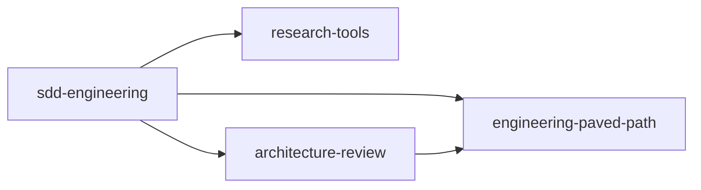

# Spec: SDD engineering plugins

Status: draft · Owner: georgsby · Last updated: 2026-10-14

Port the Spec Driven Development (SDD) workflow from [georgsby/dev-digest](https://github.com/georgsby/dev-digest) (`.claude/agents`, `.claude/skills`) into this marketplace as four plugins: one workflow plugin, `sdd-engineering`, and three reusable plugins it depends on.

## 1. Goals and non-goals

### Goals

- **G1.** `sdd-engineering` ships the four SDD agents (`spec-creator`, `implementation-planner`, `implementer`, `plan-verifier`), the `/implement` skill and the `workflow-retro` skill.
- **G2.** Components that are useful outside SDD live in their own plugins and can be installed alone: `research-tools`, `architecture-review`, `engineering-paved-path`.
- **G3.** Nothing in the plugins assumes the DevDigest repository. Paths, modules and gate commands come from explicit inputs (§6).
- **G4.** `sdd-engineering` has a README that explains how the pieces work together, and a CHANGELOG that records each release and the dependency ranges it needs (§8).

### Non-goals

Not ported (from the source repo):

- Product specs (`specs/*.md`, `specs/plans/*.md`, `specs/retros/*.md`) and the `spec-authoring` example spec.
- Secrets, `.claude/settings*.json`, `.claude/hooks/pr-gate.sh`.
- Run caches and state: `.claude/.implement/`, `.claude/.pr-self-review/`, `.claude/.dependency-checker/`, `evals/results/`, `node_modules/`.
- DevDigest-specific instructions: `CLAUDE.md`, `AGENTS.md`, `INSIGHTS.md` content, `@devdigest/shared`, the `server/`, `client/`, `reviewer-core/`, `e2e/` module names, `pnpm arch` and other repo scripts, architecture baselines.
- Agents and skills outside this scope: `architecture-reviewer-lite` (eval experiment), `test-writer`, `doc-writer`, `pr-self-review`, `dependency-checker`.

## 2. Plugins and dependency graph

| Plugin | Role | Provides | Depends on |
|---|---|---|---|
| `engineering-paved-path` | dependency | Engineering skills: React, Next.js, Fastify, architecture, testing, security, plus `engineering-insights` (§4) | — |
| `research-tools` | dependency | read-only agent `researcher` | — |
| `architecture-review` | dependency | generalized agent `architecture-reviewer` | `engineering-paved-path ^1.0.0` |
| `sdd-engineering` | workflow | agents `spec-creator`, `implementation-planner`, `implementer`, `plan-verifier`; skills `implement`, `workflow-retro`, `spec-authoring`, `mermaid-diagram` | all three above, `^1.0.0` |



`sdd-engineering` lists all three dependencies directly, even though `architecture-review` already depends on `engineering-paved-path`. Its agents preload paved-path skills themselves, and the docs don't say whether dependencies are installed transitively.

For relative-path plugins like these, an unsatisfiable range doesn't fail the install: Claude Code installs the marketplace's current copy of the dependency and leaves the dependent plugin disabled. This is why the dependency check in §8 runs in CI.

## 3. Repository layout

```text
plugins/
├── engineering-paved-path/
│   ├── .claude-plugin/plugin.json
│   ├── skills/<skill>/SKILL.md (+ rules/, references/, enforcement/ as in the source)
│   ├── README.md · CHANGELOG.md · LICENSE · THIRD_PARTY_NOTICES.md
├── research-tools/
│   ├── .claude-plugin/plugin.json
│   ├── agents/researcher.md
│   └── README.md · CHANGELOG.md · LICENSE
├── architecture-review/
│   ├── .claude-plugin/plugin.json
│   ├── agents/architecture-reviewer.md
│   └── README.md · CHANGELOG.md · LICENSE
└── sdd-engineering/
    ├── .claude-plugin/plugin.json
    ├── agents/spec-creator.md · implementation-planner.md · implementer.md · plan-verifier.md
    ├── skills/
    │   ├── implement/SKILL.md + references/{fix-loop,prompts,state}.md
    │   ├── workflow-retro/SKILL.md + references/ + scripts/{collect,narrate}.mjs
    │   ├── spec-authoring/SKILL.md + scripts/spec-lint.mjs (+ test)
    │   └── mermaid-diagram/SKILL.md + examples.md
    ├── README.md            # how the workflow fits together (§7)
    ├── CHANGELOG.md         # releases + required dependency ranges (§8)
    └── LICENSE
evals/                       # repo-level, not shipped to users (§9)
```

Four entries are added to `.claude-plugin/marketplace.json`, each with `name`, `source` (`./plugins/<name>`), `description` and `category`. `version` stays in `plugin.json` only (see [RELEASES.md](../RELEASES.md)). Every `plugin.json` has `name`, `version`, `author` (owner) and the source repository.

`sdd-engineering/.claude-plugin/plugin.json`:

```json
{
  "name": "sdd-engineering",
  "version": "1.0.0",
  "description": "Spec Driven Development: spec → plan → implement → verify → retro",
  "author": { "name": "georgsby" },
  "license": "MIT",
  "repository": "https://github.com/georgsby/dev-digest-ai-marketplace",
  "dependencies": [
    { "name": "engineering-paved-path", "version": "^1.0.0" },
    { "name": "research-tools", "version": "^1.0.0" },
    { "name": "architecture-review", "version": "^1.0.0" }
  ]
}
```

## 4. Where each skill goes

A skill goes in the lowest plugin whose agents need it. A skill used by `architecture-reviewer` cannot live in `sdd-engineering`, because `architecture-review` must work without SDD installed.

| Skill (source `.claude/skills/`) | Used by | Plugin | Notes |
|---|---|---|---|
| `react-best-practices`, `react-testing-library` | planner, implementer | `engineering-paved-path` | |
| `fastify-best-practices`, `drizzle-orm-patterns`, `postgresql-table-design`, `zod`, `typescript-expert` | planner, implementer, architecture-reviewer | `engineering-paved-path` | third-party, see §10 |
| `onion-architecture`, `frontend-architecture` | spec-creator, planner, implementer, architecture-reviewer | `engineering-paved-path` | `enforcement/*.sh` become generic checks; the DevDigest `baseline.txt` is not shipped |
| `security` | all SDD agents, architecture-reviewer | `engineering-paved-path` | |
| `engineering-insights` | every agent except researcher, `/implement`, `workflow-retro` | `engineering-paved-path` | module list replaced by "nearest `INSIGHTS.md` to the touched files, repo root for cross-module" |
| `spec-authoring` | spec-creator, planner, plan-verifier | `sdd-engineering` | the spec format is SDD-only |
| `mermaid-diagram` | spec-creator, planner | `sdd-engineering` | |
| `implement`, `workflow-retro` | user | `sdd-engineering` | user-invoked |

Not ported: `next-best-practices` (upstream `vercel-labs/next-skills` has no licence, see `THIRD_PARTY_NOTICES.md`; Next.js projects use the Next.js rules in `frontend-architecture` plus Vercel's own docs), `architecture-patterns`, `github-workflow-automation` (unused by these agents), `pr-self-review`, `dependency-checker`.

## 5. Porting rules

Apply to every agent and skill that is copied.

1. **Namespaced references.** Plugin components are addressed as `<plugin>:<name>`. Every reference is rewritten:
   - agent `skills:` preload lists: `security` → `engineering-paved-path:security`, `spec-authoring` → `sdd-engineering:spec-authoring`;
   - `tools: Agent(researcher)` → `Agent(research-tools:researcher)`;
   - agents spawned by `/implement`: `sdd-engineering:implementer`, `architecture-review:architecture-reviewer`, `sdd-engineering:plan-verifier`;
   - prose such as "invoke `react-best-practices`" → `engineering-paved-path:react-best-practices`.

   Checked with throwaway plugins on Claude Code 2.1.299 (2026-10-14):
   - `tools: Agent(<plugin>:<agent>)` works across plugins.
   - `skills: [<plugin>:<skill>]` preloads a skill from another plugin, but only when the agent runs as a **subagent**. A bare skill name is not resolved.
   - An agent run as the main thread (`claude --agent`) gets no preloaded skills at all. `spec-creator` and `implementation-planner` run that way, so their first step loads every skill they need with the Skill tool. Their `skills:` list stays as documentation and for the case where they are spawned as subagents.
2. **Supporting files via `${CLAUDE_SKILL_DIR}`.** `node .claude/skills/workflow-retro/scripts/collect.mjs` → `node "${CLAUDE_SKILL_DIR}/scripts/collect.mjs"`; same for `spec-lint.mjs`, `check-onion.sh`, `check-frontend.sh`. No path under `.claude/skills/` stays in any file.
3. **No DevDigest paths or names.** Remove `DevDigest`, `server/`, `client/`, `reviewer-core/`, `@devdigest/shared`, `pnpm arch`, `LNN-*` legacy lesson specs and the `pr-gate.sh` rule ("simple Bash only"). Replace them with the inputs in §6.
4. **Plugin-agent limits.** Claude Code ignores `permissionMode`, `hooks`, `mcpServers` and `initialPrompt` in plugin agents. `implementer` loses `permissionMode: acceptEdits`, and the README tells users to run `/implement` with edits allowed.
5. **Optional finish steps.** `/implement` phase 4 runs docs, `pr-self-review` and insights only when the project provides them. A missing step is skipped and logged, never an error.
6. **`/implement` stays manual.** Keep `disable-model-invocation: true` and `argument-hint`. The skill is named `implement` (not `run-plan`). Users type `/implement`, or `/sdd-engineering:implement` when another plugin also has an `implement` skill (both checked in the same test).

## 6. Project inputs

What the source hard-coded now comes from, in order: command arguments → the plan and spec headers → an optional project file `.claude/sdd-engineering.json` → defaults.

| Input | Default | Used by |
|---|---|---|
| `specsDir` | `specs` | spec-creator, planner, plan-verifier |
| `plansDir` | `specs/plans` | planner (saved plan), `/implement` |
| `retrosDir` | `specs/retros` | workflow-retro |
| `stateDir` | `.claude/.sdd` | `/implement` resume state (`<stateDir>/<slug>/state.md`) |
| `modules` | detected from workspace manifests (`package.json` workspaces, `pnpm-workspace.yaml`) | spec-creator (package-level specs), planner (affected modules) |
| `gates` | none; each plan task's `Verify:` commands | implementer, plan-verifier, `/implement` barrier gates |
| `architectureChecks` | none; architecture-reviewer falls back to the rules in paved-path skills | architecture-reviewer |

```json
{
  "specsDir": "docs/specs",
  "modules": ["server", "client"],
  "gates": { "typecheck": "pnpm -r typecheck", "test": "pnpm -r test" },
  "architectureChecks": ["pnpm arch"]
}
```

The planner writes the resolved gate commands into each task's `Verify:` line, so `implementer` and `plan-verifier` read them from the plan and never guess.

## 7. How it works together (content of the `sdd-engineering` README)

```text
1 spec      claude --agent sdd-engineering:spec-creator        → <specsDir>/<date>-<slug>.md (spec-lint gated)
2 plan      claude --agent sdd-engineering:implementation-planner <spec>
                                                               → <plansDir>/<date>-<slug>.md
3 execute   /sdd-engineering:implement <plan> [notes] [--from …] [--resume <slug>]
              ├─ waves of sdd-engineering:implementer (parallel, test-first, own files only)
              ├─ architecture-review:architecture-reviewer ⟲ fix rounds (max 3)
              ├─ sdd-engineering:plan-verifier ⟲ gap fixes (max 2) — traceability matrix
              └─ finish: optional docs / self-review, insights, mark implemented
4 retro     /workflow-retro [slug]                              → <retrosDir>/<date>-<slug>.md
```

The README also covers:

- install: `/plugin install sdd-engineering@dev-digest-ai` pulls in the three dependencies;
- `claude --agent spec-creator` also works without the prefix while no other installed plugin has an agent with that name;
- the human gates (start, escalations, mark implemented) and why steps 1 and 2 run in their own sessions;
- where `researcher` is used (spec-creator and planner delegate fact-finding to it);
- the project inputs (§6) and a minimal `.claude/sdd-engineering.json`;
- the edit permission note from §5.4;
- a table of every agent and skill: its job, model, tools, and what it writes.

`research-tools` and `architecture-review` each get a short README: what the agent does, how to invoke it standalone (`Agent` with `subagent_type`, or `claude --agent <plugin>:<agent>`), and its output format.

## 8. Versions and releases

- All four plugins start at **1.0.0**. They are ports of components already used in production, and the `^1.0.0` ranges need a 1.x release to resolve. This is an explicit exception to "start new plugins at 0.1.0" in [RELEASES.md](../RELEASES.md).
- Versions are bumped with `scripts/bump-version.mjs`, which writes the `CHANGELOG.md` section. The Release workflow creates `<plugin>--v<version>` tags, which the dependency ranges resolve against.
- The first release goes in one PR. One merge tags all four plugins in the same Release run, so the dependency tags exist as soon as `sdd-engineering--v1.0.0` does.
- Every `sdd-engineering` CHANGELOG section ends with a `Requires:` line listing the dependency ranges of that release, for example `Requires: engineering-paved-path ^1.0.0, research-tools ^1.0.0, architecture-review ^1.0.0`.
- A breaking change in a dependency (renamed skill or agent, changed output format that `/implement` parses) is a major bump of that dependency and needs a matching `sdd-engineering` release that widens or moves its range.
- `scripts/validate-marketplace.mjs` gains one check: every `dependencies` name is a plugin in this marketplace, and the local version of that plugin satisfies the declared range.

## 9. Evals

Evals live in a repo-level `evals/<plugin>/` folder, outside `plugins/`, so they are never copied to users' plugin cache.

- **Skills** use [`claude plugin eval`](https://code.claude.com/docs/en/plugin-evals.md): one directory per case with `prompt.md` and `graders/*.md`, run with `claude plugin eval plugins/<plugin> --eval-dir evals/<plugin>`. First suites: `spec-authoring` (spec-lint passes on a written spec) and `workflow-retro` (report written to `retrosDir`).
- **Agents.** `claude plugin eval` has no documented agent grader, so the source's vitest + Agent SDK harness is kept for `architecture-reviewer`, with its diff fixtures, rewritten to load the agent from `plugins/architecture-review/agents/`.
- The static checks (frontmatter, links, no `.claude/skills/` paths, no `DevDigest` mentions) run for all four plugins in the **Validate marketplace** workflow.
- LLM-graded evals run by hand or on a schedule, not on every PR. They need model credentials and cost money.

## 10. Open questions

1. ~~**Third-party licences.**~~ Resolved 2026-10-14: `fastify-best-practices`, `drizzle-orm-patterns`, `postgresql-table-design`, `zod` are MIT; `typescript-expert` is MIT (code) + CC-BY-4.0 (text). `next-best-practices` has no licence and is not shipped. Sources, commits and licences are in `plugins/engineering-paved-path/THIRD_PARTY_NOTICES.md`.
2. **Paved-path size.** Eleven skills in one plugin may truncate skill descriptions for users who only want React. If that shows up in practice, split it into `paved-path-frontend` and `paved-path-backend` (a major release of `engineering-paved-path`).
3. **`test-writer` and `doc-writer`.** Port them into `sdd-engineering` later, or leave the finish steps optional (§5.5)?

## 11. Delivery steps and acceptance

1. ~~Check the reference forms from §5.1 and the bare `/implement` from §5.6.~~ Done, see §5.1.
2. Copy `engineering-paved-path`, `research-tools`, `architecture-review` with the §5 rewrites; add READMEs and CHANGELOGs.
3. Copy `sdd-engineering` with the §5 rewrites and the §6 inputs; write its README (§7).
4. Add the four marketplace entries and the dependency check (§8).
5. Move the evals (§9).

Done when:

- `claude plugin validate` passes for each plugin and `node scripts/validate-marketplace.mjs` passes.
- `grep -rE 'DevDigest|devdigest|\.claude/skills/|reviewer-core' plugins/` returns nothing.
- In an empty project, `/plugin install sdd-engineering@dev-digest-ai` installs all four plugins, `/agents` lists the six agents with their namespaces, and `/sdd-engineering:implement` appears as a skill.
- `implementation-planner` can spawn `researcher`, and `/sdd-engineering:implement` can spawn `implementer`, `architecture-reviewer` and `plan-verifier` by their namespaced names.
- In a sample project, the full spec → plan → `/implement` → `/workflow-retro` run completes using only the defaults from §6.
