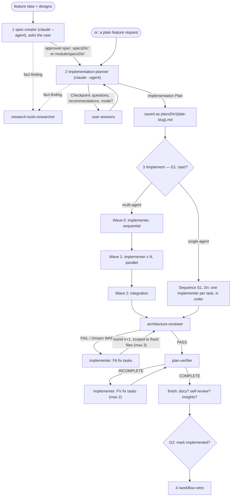

# sdd-engineering

Spec Driven Development (SDD) for Claude Code: turn a feature idea into an
approved spec, the spec into a reviewed Implementation Plan, and the plan into
tested, architecture-checked, requirement-traced code — then look back at how
the agents did. Every step leaves a file in your repository (spec, plan, run
state, retro), every requirement has an ID that is traced from the spec to a
test, and a human decides at each gate. Nothing assumes a particular project
layout: folders, modules and gate commands come from your repository or from
an optional config file.

## The flow in four steps

```text
1 spec      claude --agent sdd-engineering:spec-creator        → <specsDir>/<date>-<slug>.md (spec-lint gated)
2 plan      claude --agent sdd-engineering:implementation-planner <spec>
                                                               → <plansDir>/<date>-<slug>.md
3 execute   /implement <plan> [notes] [--from …] [--resume <slug>]
              ├─ waves of sdd-engineering:implementer (parallel, test-first, own files only)
              ├─ architecture-review:architecture-reviewer ⟲ fix rounds (max 3)
              ├─ sdd-engineering:plan-verifier ⟲ gap fixes (max 2) — traceability matrix
              └─ finish: optional docs / self-review, insights, mark implemented
4 retro     /workflow-retro [slug]                              → <retrosDir>/<date>-<slug>.md
```



**Why steps 1 and 2 run in their own sessions.** `spec-creator` and
`implementation-planner` interview you (`AskUserQuestion`), which only the
main thread can do, so you start each with `claude --agent …`. A fresh
session also keeps the spec interview out of the planner's context and the
planning out of `/implement`'s. Started as a subagent instead, each returns
its questions as a block (`## Clarification needed` / `## Checkpoint —
decisions needed`) for the calling session to ask.

1. **Spec.** `claude --agent sdd-engineering:spec-creator`, then describe the
   feature and point at designs (screenshots, HTML, Figma links if a Figma
   MCP server is connected, or the existing UI). It asks about every gap,
   edge case, cross-module hop and UX idea, records each answer as a `D-n`
   decision, writes one spec in the
   [`spec-authoring`](skills/spec-authoring/SKILL.md) format and gates it
   with `spec-lint` (0 errors). The spec starts as `draft`; it becomes
   `approved` only when you say so and no `Blocking: yes` question is open.
2. **Plan.** `claude --agent sdd-engineering:implementation-planner
   <specsDir>/<date>-<slug>.md` (a plain feature request also works — the
   plan then says `Spec: request` and numbers requirements `R1…Rn`). It
   reviews every requirement against the code, asks you to resolve what
   changes the plan, proposes better approaches and asks for the execution
   mode: **multi-agent** (waves, parallel implementers with disjoint file
   ownership) or **single-agent** (one ordered sequence). The planner is
   **read-only**: it prints the save path `<plansDir>/<YYYY-MM-DD>-<slug>.md`
   followed by the plan. Ask Claude in that same session to save it there
   ("save the plan"), review it, and edit it by hand if you like.
3. **Execute.** In a session with file edits allowed (see
   [Limits](#limits-and-notes)): `/implement <plansDir>/<date>-<slug>.md`.
   It asks G1, runs the waves, runs the gates from the plan's `## Gates`
   after every wave, loops architecture review and verification with capped
   fix rounds, writes every fix as a task in the plan's `## Amendments`, and
   keeps `<stateDir>/<slug>/state.md` so `/implement --resume <slug>` can
   continue after `/clear`, a crash or a new day.
4. **Retro.** `/workflow-retro` reads the session transcripts and writes
   token/time numbers, per-agent findings and ranked recommendations to
   `<retrosDir>/<date>-<slug>.md`. It proposes edits and applies only the ones
   you approve.

## Install

```text
/plugin marketplace add georgsby/dev-digest-ai-marketplace
/plugin install sdd-engineering@dev-digest-ai
```

Installing `sdd-engineering` also installs its three dependencies:

- [`engineering-paved-path`](../engineering-paved-path/README.md) — the
  engineering skills the agents load (architecture, React, Fastify, Drizzle,
  PostgreSQL, Zod, TypeScript, testing, security, `engineering-insights`);
- [`research-tools`](../research-tools/README.md) — the read-only
  `researcher` agent that `spec-creator` and `implementation-planner`
  delegate fact-finding to;
- [`architecture-review`](../architecture-review/README.md) — the read-only
  `architecture-reviewer` that `/implement` runs after the waves.

Check with `/agents` (six agents with their `plugin:` prefixes) and the `/` menu
(`/sdd-engineering:implement`, `/sdd-engineering:workflow-retro`).

## What's inside

### Agents

| Agent | Job | Model | Tools | Runs as | Writes |
|---|---|---|---|---|---|
| `sdd-engineering:spec-creator` | Feature idea + designs → one EARS spec, after asking you about every gap | `opus` | all except `NotebookEdit` (keeps MCP tools such as Figma) | main thread: `claude --agent sdd-engineering:spec-creator` | only spec files (`<specsDir>/…` or `<module>/<specsDir>/…`) and their `README.md` index rows |
| `sdd-engineering:implementation-planner` | Reviews existing requirements, asks, recommends, picks the mode, returns an Implementation Plan with resolved `## Gates` | `opus` | `Read, Grep, Glob, Bash, Skill, AskUserQuestion, Agent(research-tools:researcher)` | main thread: `claude --agent sdd-engineering:implementation-planner` | nothing (read-only; the session saves the plan) |
| `sdd-engineering:implementer` | Delivers exactly one plan task, test-first, only in the files the task owns | `sonnet` (or `haiku` when the task says so) | `Read, Grep, Glob, Edit, Write, Bash, Skill` | subagent of `/implement` | the task's `Owns` files only |
| `sdd-engineering:plan-verifier` | Requirements traceability matrix: plan + spec vs the working tree, with `path:line` evidence | `opus` | `Read, Grep, Glob, Bash, Skill` | subagent of `/implement` | nothing (read-only) |
| `architecture-review:architecture-reviewer` (dependency) | Layer/boundary check with severity and fix direction | `sonnet` | read-only | subagent of `/implement` | nothing |
| `research-tools:researcher` (dependency) | Answers one concrete question from the repo or the web, with evidence | `sonnet` | read-only | subagent of the spec-creator / planner | nothing |

### Skills

| Skill | Job | Invoke as | Writes |
|---|---|---|---|
| `implement` | Orchestrates step 3: waves → architecture loop → verification loop → finish, with gates G1/G2 | `/implement <plan>` (manual only) | the plan's `Status:` and `## Amendments`, `<stateDir>/<slug>/state.md`, the spec's `Status:` and index row at G2, `INSIGHTS.md` (if kept) |
| `workflow-retro` | Retro of a finished multi-agent run from the transcripts: tokens, timeline, per-agent findings, ranked recommendations | `/workflow-retro [slug]`, or ask "how did that workflow go?" | `<retrosDir>/<YYYY-MM-DD>-<slug>.md`; approved edits only |
| `spec-authoring` | The spec format: template, IDs, EARS, priorities, verify lanes, `spec-lint` | loaded by the agents; or ask about the spec format | nothing (its `spec-lint` script reads only) |
| `mermaid-diagram` | Clear Mermaid diagrams for specs and plans | loaded by the agents; or ask for a diagram | nothing by itself |

The bare names `/implement` and `/workflow-retro` work as long as no other
installed plugin has a skill with the same name; otherwise type
`/sdd-engineering:implement`. The same goes for agents:
`claude --agent spec-creator` works without the prefix while no other plugin
ships a `spec-creator`.

### Report formats `/implement` relies on

`implementer` returns `STATUS: DONE | DONE_WITH_CONCERNS | NEEDS_CONTEXT |
BLOCKED`; `architecture-reviewer` returns `VERDICT: PASS | PASS_WITH_WARNINGS
| FAIL | INCOMPLETE`; `plan-verifier` returns `VERDICT: COMPLETE | INCOMPLETE
| BLOCKED`. Both read-only agents add `TREE: unchanged | MODIFIED` — they
compare `git status --porcelain` at start and end, so `/implement` never runs
them while an implementer is still editing.

## Human gates

| Gate | When | Your choice |
|---|---|---|
| Spec approval | end of step 1 | `approved`, or another round of questions |
| Planner Checkpoint | step 2 | answers, recommendations, multi- or single-agent |
| **G1** | start of `/implement` | Start, or Stop and fix the plan/spec first (the plan becomes `approved` on Start) |
| Escalations | a fix loop hits its cap or a finding comes back | one more round / accept as recorded debt / stop and re-plan / stop |
| **G2** | end of `/implement` | mark the spec `implemented` and the plan `done`, or leave them |
| Retro edits | end of `/workflow-retro` | which proposed edits to apply |

Caps: architecture review 3 rounds, verification 2 rounds, self-review 2
rounds. `/implement` never commits or pushes.

## Project inputs

Everything the workflow needs to know about your repository comes, in this
order, from: command arguments → the plan and spec headers → an optional
`.claude/sdd-engineering.json` in the project root → defaults.

| Input | Default | Used by |
|---|---|---|
| `specsDir` | `specs` | spec-creator, planner, plan-verifier, spec-lint |
| `plansDir` | `specs/plans` | planner (save path), `/implement` |
| `retrosDir` | `specs/retros` | `/workflow-retro` |
| `stateDir` | `.claude/.sdd` | `/implement` resume state, `<stateDir>/<slug>/state.md` |
| `modules` | detected: `package.json` workspaces, `pnpm-workspace.yaml`, else top-level source folders | spec-creator (module specs), planner (Affected modules), spec-lint |
| `gates` | none — the planner derives them per module (e.g. from its `package.json` scripts) | planner → the plan's `## Gates` → implementer, plan-verifier, `/implement` barrier gates |
| `architectureChecks` | none — the reviewer falls back to the rules in the paved-path skills | planner (`## Gates`), architecture-reviewer, implementer |

With the defaults you need no config file at all. A minimal one for a
two-package repository:

```json
{
  "specsDir": "docs/specs",
  "modules": ["api", "web"],
  "gates": { "typecheck": "npm run -ws typecheck", "test": "npm run -ws test" }
}
```

The planner resolves the gate commands once and writes them into the plan's
`## Gates` table and every task's `Verify:` line, so the implementer and the
verifier read exact commands from the plan and never guess. Add `stateDir`
to `.gitignore`; specs, plans and retros are meant to be committed.

## Optional integrations

`/implement` uses these only when your project provides them; a missing one
is skipped and logged in the state file, never an error:

- a documentation agent (for example a `doc-writer`) — offered after
  verification;
- a pre-PR self-review skill (for example `pr-self-review`) — run with its
  own fix loop (cap 2);
- `INSIGHTS.md` files — read at intake and updated through
  `engineering-paved-path:engineering-insights` at the end; without them the
  insight candidates are listed in the final summary;
- architecture check scripts — through `architectureChecks` or the check
  scripts described in `engineering-paved-path:onion-architecture` and
  `engineering-paved-path:frontend-architecture`;
- services for `integration` and `e2e` test lanes (Docker, a database, a
  running app) — checked at G1; rows that cannot run are reported as
  `UNVERIFIED`, and `/implement` never starts a long-running stack itself.

## How it fits with the other plugins

`sdd-engineering` is the workflow layer. The engineering rules live in
[`engineering-paved-path`](../engineering-paved-path/README.md), the
fact-finding agent in [`research-tools`](../research-tools/README.md) and the
boundary review in [`architecture-review`](../architecture-review/README.md).
Each of those works on its own; this plugin wires them into one
spec → plan → implement → verify → retro loop.

## Limits and notes

- **Allow edits before `/implement`.** Claude Code ignores `permissionMode`
  (and `hooks`, `mcpServers`, `initialPrompt`) in plugin agents, so the
  implementers cannot auto-accept their own edits. Run `/implement` in a
  session where edits are allowed: switch to accept-edits mode (Shift+Tab),
  or allow `Edit`/`Write` for the project with `/permissions`. Bash commands
  (the gates) still go through your normal permission rules — allow the
  project's test and typecheck commands to avoid a prompt per gate.
- Read-only guarantees: the planner, `plan-verifier`, `architecture-reviewer`
  and `researcher` have no `Write`/`Edit` tools; implementers write only the
  files their task owns, by rule, and never commit.
- Parallel implementers share one working tree; the plan's disjoint `Owns`
  lists are what keeps them apart. Keep unrelated changes out of the tree
  while `/implement` runs.
- `/workflow-retro` reads Claude Code's local transcripts
  (`~/.claude/projects/<encoded project path>/`); its numbers cover this
  session and its subagents only. Its proposed edits to plugin agents or
  skills are suggestions: the plugin cache is overwritten on update, so it
  recommends a project-level override or an issue/PR to this marketplace.
- Specs are written in English with uppercase EARS keywords; the agents talk
  to you in your language.

See [CHANGELOG.md](CHANGELOG.md) for releases and the dependency ranges each
one requires.
